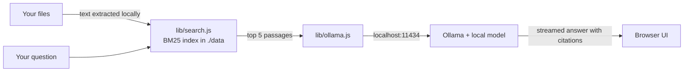

<div align="center">

# create-own-ai

**Build AI apps that run 100% on your own computer.**<br />
No API keys. No cloud. No per-user bill. Your data never leaves the machine.

[](https://www.npmjs.com/package/create-own-ai)
[](https://github.com/madhavbuilds/create-own-ai/actions/workflows/ci.yml)
[](package.json)
[](LICENSE)

```bash
npx create-own-ai my-app
cd my-app
npm run dev
```


</div>

That's the whole setup. You get a working **"chat with your files"** app at `http://localhost:3000`: drop in PDFs, Word docs, notes or a whole code folder and ask questions. Answers cite their sources, and the model runs on your laptop.

No `npm install`, no Python, no Docker, no account.

---

## Why

Cloud AI is great until you hit one of these:

- **Privacy.** People (and hospitals, law firms, schools) don't want their documents on someone else's servers.
- **Cost.** Every user costs you tokens. If your app goes viral, so does your bill.
- **Offline.** Planes, trains, rural areas and locked-down offices have no internet.
- **Setup.** Beginners need a credit card and an API key before they can even try AI.

Local models fix all four, but wiring one into an app is still fiddly. This tool does the wiring and hands you code that's small enough to read in an afternoon.

## What you get

| | |
|---|---|
| 📄 **Reads real documents** | PDF, Word (.docx), PowerPoint (.pptx), Markdown, text, CSV, JSON and 50+ code file types. Drop a whole folder and it skips `node_modules`, `.git` and build output. |
| 🔗 **Cited answers** | Answers point to their sources with `[1]` markers. Click one to see the exact passage. |
| ⚡ **Streams token by token** | With a Stop button, tokens/sec readout, and a collapsible "reasoning" panel for thinking models. |
| 🧠 **Picks a model for your machine** | 8 GB RAM → `qwen3:4b-instruct`, 16 GB → `gemma3:12b`, 32 GB+ → `qwen3:30b-instruct`. Switch to any installed model from the top bar. |
| 🪄 **First-run setup in the browser** | If Ollama or the model is missing, the page tells you and downloads the model with a progress bar. A sample file lets you try it in one click. |
| 🔒 **Private by default** | Listens only on `127.0.0.1`, blocks requests from other websites (including DNS rebinding), and stores your index as plain JSON in `./data`. |
| 📦 **Zero dependencies** | Plain Node.js. Nothing to install, nothing to break, nothing to audit but your own code. |
| 🌗 **Polished UI** | Light and dark mode, mobile layout, keyboard shortcuts, chats that survive a reload. |

<p align="center"></p>

## How it works



It's meant to be read and changed. The whole app is about 1,900 lines with no build step:

```
my-app/
├── server.js         # HTTP server + API (status, files, chat, models)
├── lib/ollama.js     # talks to the local model
├── lib/search.js     # BM25 keyword search over your files
├── lib/extract.js    # PDF / DOCX / PPTX text extraction with only Node built-ins
├── samples/          # a sample document for the one-click demo
└── public/           # the UI (HTML, CSS, JS)
```

## Requirements

- [Node.js](https://nodejs.org) 18 or newer
- [Ollama](https://ollama.com/download) (free, macOS / Windows / Linux)

The model downloads once (2.5 GB for the smallest). After that, everything works without internet.

## Options

```bash
npx create-own-ai my-app      # new folder
npx create-own-ai .           # current (empty) folder
npx create-own-ai my-app --no-git

# inside your app
MODEL=llama3.2:3b npm run dev       # use any Ollama model
PORT=8080 npm run dev               # change the port (otherwise it finds a free one)
NO_OPEN=1 npm run dev               # don't open the browser
OLLAMA_URL=http://127.0.0.1:11434 npm run dev
```

Works with `npm`, `pnpm`, `yarn` and `bun`.

## Ideas for what to build with it

- A private diary that reflects on your entries
- An offline study buddy for your lecture notes
- A contract or policy Q&A tool for a small office
- A support bot over your product docs that costs $0 to run
- A code-base explainer for your own projects

Built something? [Show it off in Discussions](https://github.com/madhavbuilds/create-own-ai/discussions). We'd love to see it.

## FAQ

**How is this different from Open WebUI, LM Studio or Ollama's own app?**
Those are finished apps you use. This is a starter you *own*: a small, dependency-free codebase you can rename, restyle, and turn into your own product. It's closer to `create-react-app` than to a chat client.

**Is it really private?**
The server binds to `127.0.0.1`, so other devices on your network can't reach it. It only talks to Ollama on your machine. The only internet access ever is the one-time model download, which Ollama does. Your files are stored in `./data/index.json`; delete that folder to wipe everything.

**Can it read scanned PDFs?**
Not yet. Scans are images with no text layer, and the app will tell you when it finds one. OCR is on the roadmap.

**Why keyword search instead of embeddings?**
BM25 needs no second model, indexes instantly, and works well for "find the passage about X" questions. Semantic search with local embeddings is on the roadmap as an option.

**Does it work on Windows?**
Yes. Node and Ollama both run on Windows, and CI tests on Windows, macOS and Linux.

## Roadmap

- [x] PDF, DOCX and PPTX support
- [x] Model switcher, stop button, chat history
- [ ] More templates: voice assistant, summarizer, photo search
- [ ] Semantic search with local embeddings (opt-in)
- [ ] OCR for scanned PDFs
- [ ] `npm run build` to package the app as a desktop installer (.dmg / .exe)
- [ ] Choose between Ollama, llama.cpp and other local runtimes

Want one of these? Open an issue, or better, a PR.

## Contributing

Bug reports, templates and ideas are all welcome. See [CONTRIBUTING.md](CONTRIBUTING.md). Run the tests with `npm test`; no model needed.

If this saved you time, a ⭐ helps other people find it.

## License

[MIT](LICENSE)
